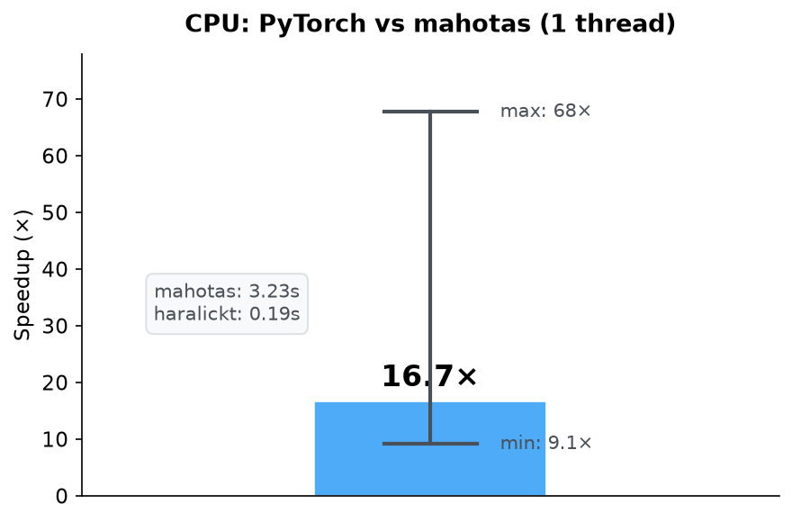
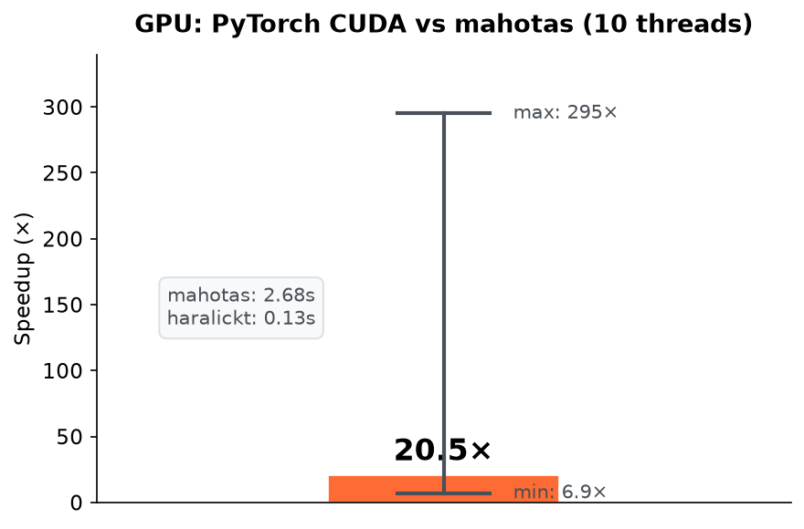
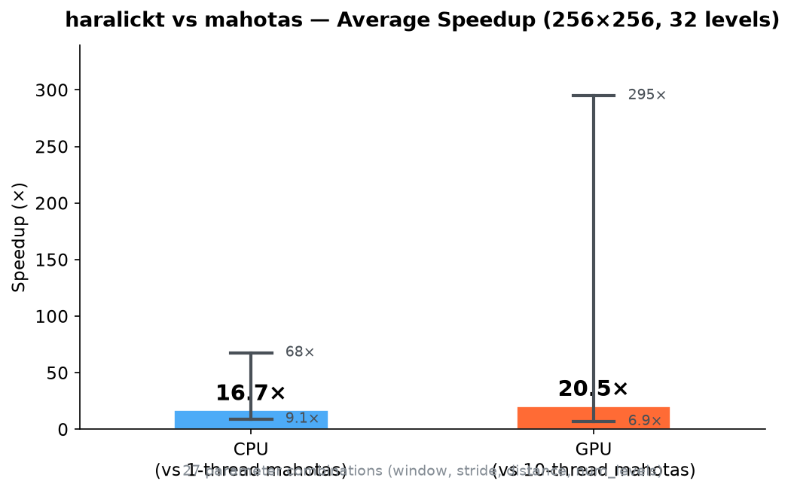

# haralickt

> Fast Haralick texture features (GLCM) for PyTorch

**haralickt** is a high-performance library for computing Haralick texture features (Gray-Level Co-occurrence Matrix, GLCM) using PyTorch. It provides a drop-in replacement for `mahotas.features.haralick` with **9x to 68x speedup** on CPU and up to **295x** on GPU.

## Features

- **13 standard Haralick features**: ASM, Contrast, Correlation, Variance, IDM, Sum Average, Sum Variance, Sum Entropy, Entropy, Diff Variance, Diff Entropy, IMC1, IMC2
- **Drop-in replacement for mahotas**: same API, same output format `(4, 13)`
- **PyTorch backend**: works on CPU and GPU (CUDA)
- **Sliding window API**: compute features at every pixel position with configurable window size and stride
- **Tiling support**: process large images in tiles to control memory usage
- **NumPy input**: accept both `torch.Tensor` and `numpy.ndarray`
- **Zero dependencies beyond PyTorch**: no C extensions, no compilation needed

## Installation

```bash
pip install haralickt
```

Or from source:

```bash
git clone https://github.com/youruser/haralickt.git
cd haralickt
pip install -e .
```

**Requirements:**
- Python >= 3.9
- PyTorch >= 2.0
- NumPy >= 1.23

## Quick Start

### Drop-in replacement for mahotas

```python
import numpy as np
from haralickt.features import haralick

# Your grayscale image (H x W, values 0..255)
image = np.random.randint(0, 256, (256, 256), dtype=np.uint8)

# Same API as mahotas.features.haralick
features = haralick(image, ignore_zeros=True, distance=1)
print(features.shape)  # (4, 13)
```

### Sliding window API (original)

```python
import torch
from haralickt import haralick

image = torch.randint(0, 32, (256, 256))

features = haralick(
    image,
    num_levels=32,
    window_size=32,
    stride=8,
    device="cpu",  # or "cuda"
)
print(features.shape)  # (29, 29, 13)
```

### Reusable engine

```python
from haralickt import HaralickConfig, HaralickEngine

config = HaralickConfig(
    num_levels=32,
    window_size=32,
    stride=8,
    tile_size=128,
    device="cpu",
)
engine = HaralickEngine(config)

# Process multiple images with the same config
for image in image_batch:
    features = engine.compute(image)
```

## API Reference

### `haralickt.features.haralick(image, ignore_zeros=True, distance=1)`

Drop-in replacement for `mahotas.features.haralick`.

| Parameter | Type | Default | Description |
|-----------|------|---------|-------------|
| `image` | `ndarray` | — | 2D grayscale image, values in `[0, 255]` |
| `ignore_zeros` | `bool` | `True` | Exclude zero-valued pixels from GLCM |
| `distance` | `int` | `1` | Pixel distance for co-occurrence (1, 2, or 4) |

**Returns:** `np.ndarray` of shape `(4, 13)` — one row per direction (0°, 45°, 90°, 135°), 13 features per direction.

### `haralickt.haralick(image, num_levels, window_size, stride, ...)`

Sliding-window Haralick feature extraction.

| Parameter | Type | Default | Description |
|-----------|------|---------|-------------|
| `image` | `Tensor` | — | 2D image tensor, values in `[0, num_levels-1]` |
| `num_levels` | `int` | `32` | Number of gray levels |
| `window_size` | `int` | `32` | Window size for local GLCM |
| `stride` | `int` | `8` | Step between windows |
| `tile_size` | `int` | `1024` | Tile size for memory-efficient processing (must be a multiple of `stride`) |
| `device` | `str` | `"cpu"` | Compute device (`"cpu"`, `"cuda"`, `"cuda:0"`) |

**Returns:** `Tensor` of shape `(H_out, W_out, 13)`.

### `haralickt.HaralickEngine(config)`

Reusable engine that caches configuration for batch processing.

### `haralickt.HaralickConfig`

Configuration dataclass with validation.

## Feature Names

| Index | Name | Description |
|-------|------|-------------|
| 0 | ASM | Angular Second Moment (Energy) |
| 1 | Contrast | Local intensity variation |
| 2 | Correlation | Linear dependency between rows/cols |
| 3 | Variance | Deviation from mean |
| 4 | IDM | Inverse Difference Moment (Homogeneity) |
| 5 | Sum Average | Mean of sum of GLCM |
| 6 | Sum Variance | Variance of sum of GLCM |
| 7 | Sum Entropy | Entropy of sum of GLCM |
| 8 | Entropy | Information content |
| 9 | Diff Variance | Variance of difference of GLCM |
| 10 | Diff Entropy | Entropy of difference of GLCM |
| 11 | IMC1 | Information Measure of Correlation 1 |
| 12 | IMC2 | Information Measure of Correlation 2 |

> **Note on feature #10 (Diff Entropy):** This feature is implemented to match `mahotas` behavior exactly. It does **not** follow the original Haralick (1973) paper definition. If you need the paper-correct formula, you will need to adjust the computation in `feature_math.py`.

## Performance
### Accuracy

Comparison with mahotas (256x256 image, 32 gray levels, 27 parameter combinations):
- Maximum discrepancy: **2.02e-4** (float32 rounding, *Diff Variance* feature)
- Mean discrepancy: **~1.1e-6**
- Worst case: `window=8, stride=2, distance=4` and `window=8, stride=4, distance=4`

### Speed

256x256 image, 32 gray levels, Python 3.12:

| Scenario | mahotas (avg) | haralickt (avg) | Speedup |
|----------|:---:|:---:|:---:|
| PyTorch **CPU** vs mahotas **CPU (1 thread)** | 3.23s | 0.19s | **16.7x** |
| PyTorch **GPU (CUDA)** vs mahotas **CPU (10 threads)** | 2.68s | 0.13s | **20.5x** |

Speedup range across combinations:

| Scenario | Min | Max |
|----------|:---:|:---:|
| CPU vs CPU (1 thr) | 9.1x | 67.7x |
| GPU vs CPU (10 thr) | 6.9x | 295x |







> **Note:** CPU speedup is achieved through PyTorch multi-threading (OpenMP/MKL). When mahotas is also run with 10–12 threads, the gap is largely neutralized. The real advantage of `haralickt` is **GPU acceleration**: on CUDA, `haralickt` is **~20x faster** than multi-threaded mahotas (10 threads).

### Comparison with other libraries

| Feature | haralickt | mahotas | scikit-image |
|---------|:---------:|:-------:|:------------:|
| GPU (CUDA) | ✅ | ❌ | ❌ |
| Haralick features | 13 | 13 | 10 |
| Missing features | — | — | 3 |
| Sliding window API | ✅ | ❌ | ❌ |
| Tiling (large images) | ✅ | ❌ | ❌ |
| Batch processing | ✅ | ❌ | ❌ |
| Backend | PyTorch | C (OpenMP) | NumPy |

Full benchmark: `python examples/compare_with_mahotas.py`

## Project Structure

```
src/haralickt/
├── __init__.py          # Public API exports
├── features.py          # mahotas-compatible API (features.haralick)
├── api.py               # Sliding-window API (haralick, haralick_from_numpy)
├── engine.py            # HaralickEngine (reusable, config-cached)
├── config.py            # HaralickConfig dataclass
├── feature_math.py      # 13 Haralick feature computations
├── glcm.py              # GLCM construction (4 directions)
├── tiling.py            # Memory-efficient tiling
├── device.py            # Device resolution utilities
└── validation.py        # Input validation
```

## Testing

```bash
python -m pytest tests/ -v
```

34 tests covering: config validation, edge cases, tiling consistency, mahotas compatibility, and engine reuse.

## License

Mozilla Public License 2.0 (MPL-2.0)
